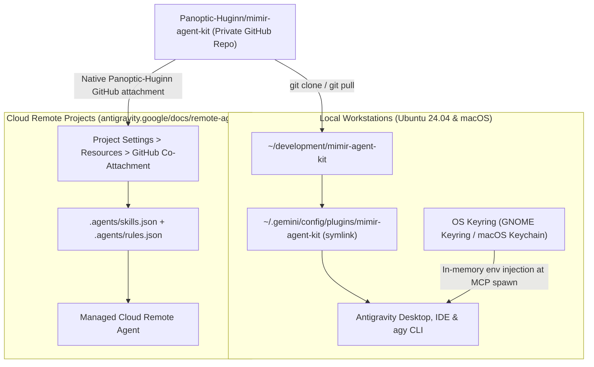

# Mimir Agent Kit (`mimir-agent-kit`)

Custom **Google Antigravity 2.29.0+** engineering plugin, skill suite, GitHub Flow lifecycle rules, and portable research Model Context Protocol (MCP) bundle shared across **Ubuntu Linux 24.04**, **macOS**, and **Cloud Remote Projects (`remote-agents`)**.

Named after **Mimir** (Norse keeper of the well of wisdom and advisor to Odin, complementing `Panoptic-Huginn` and `heimdall-astro`), this repository contains **exclusively custom first-party customizations**—zero duplicated Google Marketplace or Data Cloud skills and **zero plaintext secrets**.

---

## Architecture Overview

A single Git repository simultaneously supports **local desktop/CLI plugin mode** (`plugin.json`) and **Cloud `remote-agents` workspace discovery** (`.agents/skills.json` + `.agents/rules.json`):



---

## Bundled Customizations

### 1. Custom Engineering Skills (`skills/`)

| Skill (`/slash`) | Domain & Toolchain Focus | Bundled Assets |
| :--- | :--- | :--- |
| `ada-spark-pro` | Formally verified SPARK Ada 2022 (`GNAT 16.1+`, `gnatprove 16.1+` Silver/Gold proofs, `alr 2.1+`, Jorvik real-time tasks, C23 ABI) | `examples/{alire.toml,gnat.adc,spark_project.gpr}`, `references/` |
| `c-pro` | Deterministic ISO C23 (`-std=c23`), LLVM Clang 23.1+ / Apple Clang 21.0+, NVIDIA Halos real-time safety kernels, CERT C / MISRA C | `examples/.clang-format`, `examples/.clang-tidy` |
| `cmake-pro` | Modern CMake 4.4.3+ target-based `cmake/` modules, ISA/SIMD compile probes, Vcpkg manifest mode, `CMakePresets.json` v10+, `gersemi` | `references/canonical_templates.md` |
| `cpp-pro` | High-performance ISO C++23, RAII, Google Style + C++ Core Guidelines, Google Test, Google Benchmark, ASan/TSan/UBSan | `examples/.clang-format`, `examples/.clang-tidy` |
| `github-flow-lifecycle` | 6-stage Git & GitHub Flow code-delivery protocol: issue tracking, `<type>/<N>-<slug>` branch isolation, mandatory pre-commit local CI gate, PR self-healing | `references/`, paired with `rules/AGENTS.md` |
| `github-ops` | Non-code GitHub & GHEC (`Panoptic-Huginn`) operations: repo provisioning/hardening, org & repo rulesets, custom properties, sub-issues/Projects v2, security triage, releases | `references/ghec-governance-and-recipes.md` |
| `jupyter-pro` | Reproducible Jupyter Notebook & Google Colab engineering workflows (`uv`, Python 3.14+, clean-output hygiene) | — |
| `marimo-pair` | Live marimo reactive kernel driving, in-memory DAG state inspection, and durable notebook commits via `marimo._code_mode` | `scripts/`, `references/` |
| `marimo-pro` | Reactive marimo Python notebooks, `mo.ui` widgets, DAG execution, `mo.state`, and dual `pixi`/`uv` toolchains | `references/` |
| `python-pro` | Production Python 3.14+ (`uv`, `pixi`, `ruff`, `mypy --strict`, `pydantic`, `pytest`, `rumdl`, Google docstrings) | `examples/pyproject.toml` |
| `rust-pro` | Deterministic Rust 1.99.1+ (`std`, `no_std`, bare-metal), Pixi orchestration, NVIDIA Halos safety kernels, Google Rust Styleguide, RISC-V RVA23 | `examples/{pixi.toml,Cargo.toml,clippy.toml,rustfmt.toml}`, `references/` |

> [!NOTE]
> First-party Google skills (such as BigQuery, Dataflow, Dataproc/Spark, Cloud Databases, and `google-agents-cli-*`) are intentionally excluded from this repository. Install those per machine from **Customizations > Marketplace** inside Antigravity so Google updates them automatically.

### 2. Always-On Rules

- **`rules/AGENTS.md`**: Always-on Git & GitHub governance mandate enforcing dual-owner routing (`jamielapointe` vs. `Panoptic-Huginn`), `github-mcp-server` remote operations, `/github-flow-lifecycle` code-delivery gates vs. `/github-ops` control-plane routing, destructive-action human consent, and human-only PR merges.

### 3. Portable Research & Developer MCP Suite (`mcp_config.json`)

| MCP Server | Launcher | Purpose | OS Keyring Variables (`variables`) |
| :--- | :--- | :--- | :--- |
| `github` | `uv run --isolated --no-project ... scripts/github_mcp_launcher.py --cache-dir ${PLUGIN_DATA}` | SHA-256-verified native `github-mcp-server` `v2.1.0` binary (zero Docker) for Issues, PRs, Rulesets, Projects, Security & Logs across **all** owners your `gh` login can reach | None (token from `gh auth token` at launch) |
| `academic-mcp` | `uv run --isolated --no-project --with mcp==2.3.0 ... scripts/academic_mcp_server.py` | Standalone zero-repo-dependency SQLite FTS5 BM25 paper/chunk search (Pixi-safe) | `ACADEMIC_CORPUS_DB_PATH` |
| `arxiv` | `uvx mcp-arxiv==0.1.0` | arXiv preprint search and metadata retrieval | None |
| `europe-pmc` | `npx -y @cyanheads/pubmed-mcp-server@2.12.0` | PubMed / Europe PMC biomedical & life-science literature search | None |
| `semscholar` | `uvx --with pydantic-settings==2.16.2 --with mcp[cli]==1.30.0 semantic-scholar-mcp==0.4.0` | Semantic Scholar paper graph, citations, and author lookup | None |
| `nasa_ads` | `uvx --with mcp==1.30.0 nasa-ads-mcp==0.1.0` | NASA Astrophysics Data System (ADS) astrodynamics & physics literature | `ADS_API_TOKEN` |
| `zotero` | `uvx zotero-mcp-server==0.15.2` | Zotero library search, collections, annotations, and BibTeX export | `ZOTERO_API_KEY`, `ZOTERO_LIBRARY_ID` |
| `workspace` | `uvx workspace-mcp==2.3.0 --single-user` | Gmail, Google Drive, Docs, Sheets, Slides, and Calendar | `GOOGLE_OAUTH_CLIENT_ID`, `GOOGLE_OAUTH_CLIENT_SECRET`, `USER_GOOGLE_EMAIL` |
| `jupyter` | `uvx --with mcp==1.30.0 mcp-server-jupyter==0.1.9` | Local Jupyter notebook cell inspection and execution | None |
| `time` | `uvx mcp-server-time==2026.11.4` | Timezone-aware clock and timestamp conversion | None |

> [!IMPORTANT]
> Antigravity registers plugin tools as `mcp_<plugin>_<server>_<tool>` and drops any identifier longer than 64 characters (`^[a-zA-Z0-9_-]{1,64}$`). With the 20-character prefix `mcp_mimir-agent-kit_`, server keys are kept short (`github`, `workspace`, `semscholar`), and GitHub tools that still don't fit are listed in `GITHUB_EXCLUDE_TOOLS`. After adding a server or bumping a pinned version, refresh the tool inventory with `uv run python scripts/ci/snapshot_mcp_tools.py`. Export the server's `${VAR}` secrets first. The script writes `scripts/validation/mcp_tool_manifest.json`, which `validate_agentic_settings.py --strict` (`MCP008`) and `pytest` enforce offline in CI.

---

## How Secret Storage Works (Zero Plaintext Keys on Disk)

`mcp_config.json` never stores secret values. Instead, every server requiring credentials declares structured `${VAR_NAME}` placeholders alongside a `variables` metadata array:

1. **OS-Native Encrypted Keyring Storage**: When you enter values in Antigravity's Plugin UI (or via the `agy` CLI), Antigravity invokes `SavePluginMcpVariables` backed by your operating system's native secret store (`go-keyring`):
   - **Ubuntu 24.04**: Encrypted inside **GNOME Keyring / FreeDesktop Secret Service** (`libsecret` / `Passwords and Keys`).
   - **macOS**: Encrypted inside **macOS Login Keychain** (`Keychain Access.app`).
   - **Headless Linux Fallback**: Only if D-Bus Secret Service is absent does Antigravity fall back to a `0600` local credential store under `~/.gemini/`.
2. **In-Memory Runtime Injection**: Whenever Antigravity spawns an MCP child process (`uvx`, `uv`, `npx`), the Language Server reads the secret from the OS Keyring and injects it directly into the child process's environment in memory. Your Git working tree (`~/development/mimir-agent-kit`) stays 100% clean across `git status` and `git pull`.
3. **GitHub uses a Docker-free SHA-256-pinned native binary + `gh` keyring token**: `scripts/github_mcp_launcher.py` downloads the official `github/github-mcp-server` `v2.1.0` release archive once into `${PLUGIN_DATA}`, verifies its 64-character SHA-256 digest in memory before extraction, reads `gh auth token --hostname github.com` from your OS keyring (`libsecret` on Ubuntu, Login Keychain on macOS), and `exec`s `github-mcp-server stdio` directly with `GITHUB_PERSONAL_ACCESS_TOKEN` in memory (never in `argv` or on disk). One `gh` OAuth login covers both your personal account (`jamielapointe`) and GitHub Enterprise Cloud organizations (`Panoptic-Huginn`), with **zero Docker daemon required** on macOS or Linux.
4. **Safe First-Boot Gating**: Because `mcp_config.json` declares `variables`, Antigravity automatically keeps `mimir-agent-kit` in a **Configure / Setup Required** state on a newly cloned machine until you fill in its variables once. (If enabled beforehand, `scripts/academic_mcp_server.py` safely falls back to `~/.local/share/mimir-agent-kit/academic_corpus.db`.)

---

## Local Installation & Cutover Guide (Ubuntu 24.04 & macOS)

### Prerequisites

Ensure these CLI runtimes are installed and on `PATH` on both Ubuntu 24.04 and macOS (**zero Docker daemon required**):

- **`git`** and **`uv`** (`>= 0.10`, provides both `uv` and `uvx`) — `curl -LsSf https://astral.sh/uv/install.sh | sh`
- **Node.js / `npx`** (`>= 22`, used by `europe-pmc`)
- **GitHub CLI** (`gh`, authenticated once per machine with `gh auth login --hostname github.com --git-protocol ssh`). Recommended full-capability scope refresh for `Panoptic-Huginn` Enterprise Organization Owner + Actions + Projects: `gh auth refresh --hostname github.com --scopes repo,read:org,workflow,admin:org,project,notifications`.

### Step 1: Clone & Symlink into Antigravity's Global Plugins Directory

Run the exact same commands on **Ubuntu 24.04** and **macOS**:

```bash
# 1. Clone into your local development directory
mkdir -p ~/development
git clone git@github.com:Panoptic-Huginn/mimir-agent-kit.git ~/development/mimir-agent-kit

# 2. Register as a global Antigravity plugin via symlink (so `git pull` updates live)
mkdir -p ~/.gemini/config/plugins
ln -sfn ~/development/mimir-agent-kit ~/.gemini/config/plugins/mimir-agent-kit
```

> [!TIP]
> Whenever you want to edit skills, hooks, or MCP definitions directly inside Antigravity, open `~/development/mimir-agent-kit` as your active workspace.

### Step 2: Cut Over from Legacy Cloud-Drive Symlinks (One-Time Cleanup)

If your machine previously symlinked `~/.gemini/config/skills` or copied `AGENTS.md` / `hooks.json` / `mcp_config.json` from a mounted cloud drive:

```bash
# 1. Back up your previous ~/.gemini/config state before cutting over
cp -a ~/.gemini/config ~/.gemini/config.pre-mimir-backup

# 2. Remove the old cloud-drive skills symlink and replace with an empty local skills folder
#    (only if ~/.gemini/config/skills is currently a symlink)
if [ -L ~/.gemini/config/skills ]; then
  rm ~/.gemini/config/skills
  mkdir -p ~/.gemini/config/skills
fi

# 3. Remove duplicate global rule/hook files now provided by mimir-agent-kit
rm -f ~/.gemini/config/AGENTS.md ~/.gemini/config/hooks.json
rm -rf ~/.gemini/config/scripts
```

Next, inspect `~/.gemini/config/mcp_config.json` and remove server entries that are now bundled inside `mimir-agent-kit` (`github` / `github-mcp-server`, `academic-mcp`, `arxiv`, `europe-pmc`, `semscholar` / `semantic-scholar`, `nasa_ads`, `zotero`, `workspace` / `google-workspace`, `jupyter`, `time`) so Antigravity does not spawn duplicate MCP server processes. Keep any machine-specific or project-only global servers if desired.

### Step 3: Enter Secret Keys in Antigravity (Stored in OS Keyring)

1. **Restart Antigravity** (Desktop App or IDE) so startup discovery detects `~/.gemini/config/plugins/mimir-agent-kit`.
2. Open **Customizations**:
   - **Antigravity Desktop / IDE**: Click **Additional Options (`...`) > Customizations > Plugins** (or open `customization://mimir-agent-kit`), then select **Mimir Agent Kit**.
   - **`agy` CLI**: Launch `agy` and run `/plugin` to open the interactive plugin manager.
3. Click **Configure** (or fill in the **Variables** form) on **Mimir Agent Kit**:
   - **GitHub**: no variable to enter. Run `gh auth login --hostname github.com` once per machine (verify with `gh auth status`); the `github` MCP server reads `gh auth token` at startup.
   - **`ACADEMIC_CORPUS_DB_PATH`**: Path to your local SQLite corpus DB:
     - Ubuntu / macOS with `heimdall-astro` checked out: `~/development/heimdall-astro/data/papers/academic_corpus.db`
     - Machine without `heimdall-astro`: `~/.local/share/mimir-agent-kit/academic_corpus.db` (auto-initialized on first launch).
   - **`ADS_API_TOKEN`**: Your NASA ADS API token (`https://ui.adsabs.harvard.edu/user/settings/token`).
   - **`ZOTERO_API_KEY`** & **`ZOTERO_LIBRARY_ID`**: From `https://www.zotero.org/settings/keys`.
   - **`GOOGLE_OAUTH_CLIENT_ID`**, **`GOOGLE_OAUTH_CLIENT_SECRET`**, **`USER_GOOGLE_EMAIL`**: Desktop OAuth 2.0 client credentials from Google Cloud Console (`https://console.cloud.google.com/apis/credentials`). On first `workspace` tool call, complete the one-time browser OAuth consent prompt.
4. Toggle **Mimir Agent Kit** **Enabled**. Verify active tools under **Additional Options (`...`) > MCP Servers**.

---

## Using `mimir-agent-kit` in Cloud `remote-agents`

Google Antigravity [Remote Agents](https://antigravity.google/docs/remote-agents) execute inside Google-managed cloud sandboxes attached to GitHub repositories rather than your laptop's `~/.gemini/config`. Because this repository ships `.agents/skills.json` and `.agents/rules.json` at its root, Remote Projects discover all 11 skills and `rules/AGENTS.md` natively.

### Option A (Recommended): Native Multi-Repo Attachment in `Panoptic-Huginn`

Because `Panoptic-Huginn/mimir-agent-kit` lives in the same GitHub organization as your `Panoptic-Huginn` workload repositories:

1. Open your Remote Project at [antigravity.google](https://antigravity.google) (or inside the Antigravity app).
2. Navigate to **Project Settings > Resources > Add Resource > GitHub**.
3. Select **`Panoptic-Huginn/mimir-agent-kit`** (`main` branch) alongside your primary project repository (for example, `Panoptic-Huginn/heimdall-astro`).
4. Start a new Remote Agent session. Antigravity mounts both repositories into the cloud workspace and automatically ingests `.agents/skills.json` (`skills/*`) and `.agents/rules.json` (`rules/AGENTS.md`).

### Option B (Cross-Org Fallback): Git Submodule under `.agents/plugins/`

If you create a Remote Project backed by a repository outside `Panoptic-Huginn` where cross-organization attachment is not configured, mount `mimir-agent-kit` as a plugin submodule inside that repository:

```bash
git submodule add git@github.com:Panoptic-Huginn/mimir-agent-kit.git .agents/plugins/mimir-agent-kit
git commit -m "chore(agents): attach mimir-agent-kit plugin submodule"
```

### Cloud Sandbox Notes & CLI Requirement

- **Cloud MCP & Connectors**: Local `stdio` MCP binaries and host filesystems (such as local Zotero/SQLite paths) do not run inside managed Remote Agent sandboxes. In Remote Projects, all **11 custom skills** and **`rules/AGENTS.md`** load automatically, while GitHub and Google Workspace access use Antigravity's native cloud account connectors (**Settings > Integrations / Accounts**) or `gh` CLI.
- **CLI Version for `--remote-agent`**: Launching or attaching to Remote Agent sessions from a terminal (`agy --remote-agent`) requires `agy >= 1.4.12`. Upgrade via `agy update` if `agy --version` reports `1.4.11` or earlier.

---

## Day-to-Day Sync & Contribution Workflow

### Pulling Updates on Ubuntu 24.04 or macOS

Because `~/.gemini/config/plugins/mimir-agent-kit` is a symlink to `~/development/mimir-agent-kit`, pulling `main` updates every skill, rule, hook, and MCP definition in place:

```bash
git -C ~/development/mimir-agent-kit pull --ff-only origin main
```

*(Restart Antigravity only if `plugin.json`, `mcp_config.json`, or newly added skill directories changed; edits to existing `SKILL.md` bodies apply immediately.)*

### Local CI & Validation Gate

Before committing any change on a feature branch (`<type>/<issue-number>-<slug>` per `/github-flow-lifecycle`), run the full local verification gate:

```bash
# 1. Validate strict Antigravity plugin schema, hooks, MCP variables & 24 KB skill body limits
agy plugin validate --strict .

# 2. Run Python linter, formatter check, strict static typing, Markdown linter & unit tests
uv sync --locked
uv run ruff check .
uv run ruff format --check .
uv run mypy
uv run rumdl check .
uv run pytest -v
```

---

## License

Licensed under the [Apache License, Version 2.0](./LICENSE).
